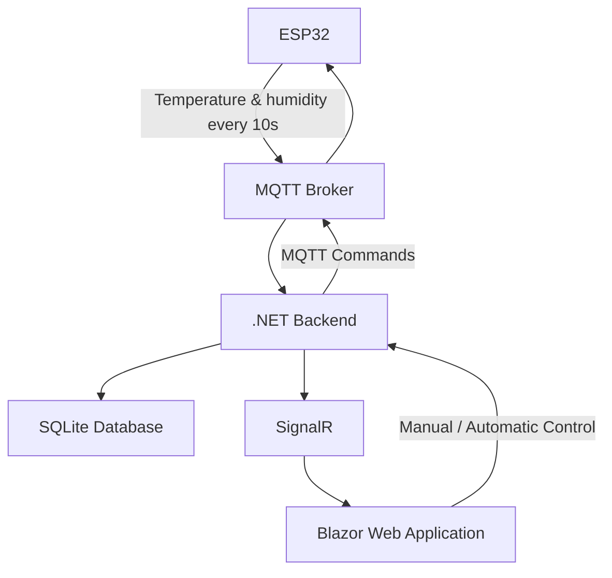

# Industry 4.0 – IoT Monitoring & Control System

An IoT application built with **.NET, Blazor, ESP32, and MQTT** for real-time environmental monitoring and actuator control. The system collects temperature and humidity data, stores measurements, provides real-time updates, and enables manual or scheduled control of LED actuators.

---

## Overview

Industry04 is an IoT monitoring and control platform designed to connect physical hardware with a web-based application. An ESP32 device periodically collects environmental data and publishes it through MQTT to a backend application, where measurements are processed and stored.

The application provides a dashboard for monitoring sensor data, managing alarm rules, and controlling actuators, with real-time communication powered by SignalR.

## Features

- **Real-time monitoring** – Temperature and humidity measurements.
- **ESP32 integration** – Sensor data collection and LED actuator control.
- **MQTT communication** – Lightweight messaging between the IoT device and backend.
- **Data persistence** – Historical sensor measurements stored in SQLite.
- **Real-time updates** – Live data delivery using SignalR.
- **Actuator control** – Manual and automatic operating modes.
- **Scheduled automation** – Configure operating schedules based on weekdays and time intervals.
- **Alarm rules** – Create and persist custom rules for environmental conditions.
- **Alarm monitoring** – View triggered alarms based on configured rules.
- **Authentication & authorization** – Registration, login, JWT authentication, access and refresh tokens.
- **Email confirmation** – Account confirmation flow.
- **Clean Architecture** – Separation of concerns and modular design to make the system easier to maintain and extend.

## System Architecture

The system consists of three main components: an ESP32-based IoT device, a backend application, and a Blazor frontend.



### Data Flow

1. ESP32 reads temperature and humidity from connected sensors.
2. Measurements are published through MQTT approximately every 10 seconds.
3. The backend receives and processes incoming MQTT messages.
4. Sensor data and relevant application data are persisted in SQLite.
5. SignalR pushes real-time updates to connected clients.
6. The Blazor application displays the latest readings and historical stored data.
7. Users can manage alarm rules and actuator operating modes through the UI.
8. Control commands are communicated back to the ESP32 through the MQTT infrastructure.

## Technology Stack

| Technology | Purpose |
|---|---|
| C# / .NET | Backend application and business logic |
| Blazor | Interactive web user interface |
| ESP32 | IoT device, sensor readings and actuator control |
| MQTT | IoT messaging and communication |
| SignalR | Real-time client-server updates |
| SQLite | Lightweight data persistence |
| JWT | Authentication |
| Access & Refresh Tokens | Token-based authentication lifecycle |
| Clean Architecture | Separation of application responsibilities |

## IoT Functionality

### Environmental Monitoring

The ESP32 periodically measures environmental conditions:

- Temperature
- Humidity

Measurements are transmitted to the backend via MQTT every **10 seconds** and stored for later access through the application.

The dashboard provides access to current readings as well as previously stored measurements.

### LED Actuator Control

The application supports two actuator operating modes:

| Mode | Description |
|---|---|
| **Manual** | Users can manually turn LEDs on or off through the application. |
| **Automatic** | LED operation follows a configured schedule based on selected weekdays and time intervals. |

This allows the system to switch between direct user control and scheduled automation.

## Real-Time Communication

SignalR is used to provide real-time communication between the backend and the Blazor frontend.

When new sensor measurements arrive, clients can receive updates without manually refreshing the page.

Real-time functionality includes:

- Live temperature updates
- Live humidity updates
- Display of the latest sensor readings
- Responsive dashboard updates

## Alarm System

The backend includes an alarm rules system that allows users to configure and persist conditions for monitoring environmental measurements.

Users can create alarm rules based on sensor values and use the application to monitor triggered alarms.

### Alarm Capabilities

- Create alarm rules
- Persist configured rules
- Define conditions based on monitored values
- Monitor triggered alarms through the application

The alarm system is designed to make environmental monitoring more flexible by allowing conditions to be configured instead of hardcoded.

## Authentication & Security

The application includes an authentication system implemented on the backend.

### Implemented Authentication Features

- User registration
- Login
- JWT authentication
- Access tokens
- Refresh tokens
- Email confirmation

The authentication flow is designed to provide secure access to application functionality and support authenticated communication between the frontend and backend.

## Data Storage

**SQLite** is currently used as the database.

SQLite was chosen for its lightweight nature, minimal setup requirements, and suitability for the current stage of the project.

The backend follows a Clean Architecture approach, keeping persistence concerns separated from core application logic, making it easier to replace SQLite with another database provider in the future if needed.

## Architecture & Design Principles

The backend is structured around **Clean Architecture** principles, with an emphasis on:

- Separation of concerns
- Maintainability
- Dependency isolation
- Testability
- Extensibility
- Database provider flexibility

The goal is to keep business logic independent of infrastructure-specific implementations wherever possible.

## Getting Started

### Prerequisites

Before running the project, make sure you have the following installed and configured:

- [.NET SDK](https://dotnet.microsoft.com/download)
- An MQTT broker
- SQLite (if needed for database inspection)
- ESP32 hardware with the appropriate sensors and LED actuators

### Installation

Clone the repository:

```bash
git clone https://github.com/0marinkec0/Industry04.git
cd Industry04
```

Restore .NET dependencies:

```bash
dotnet restore
```

Build the project:

```bash
dotnet build
```

Run the application using the appropriate backend and frontend project configurations within the solution.

> Specific project startup commands and MQTT configuration depend on the project setup.

## Project Status

The project currently includes core IoT monitoring, backend processing, data persistence, authentication, real-time communication, alarm rules, and actuator control functionality.

The system is actively evolving, with further improvements and extensions planned.
